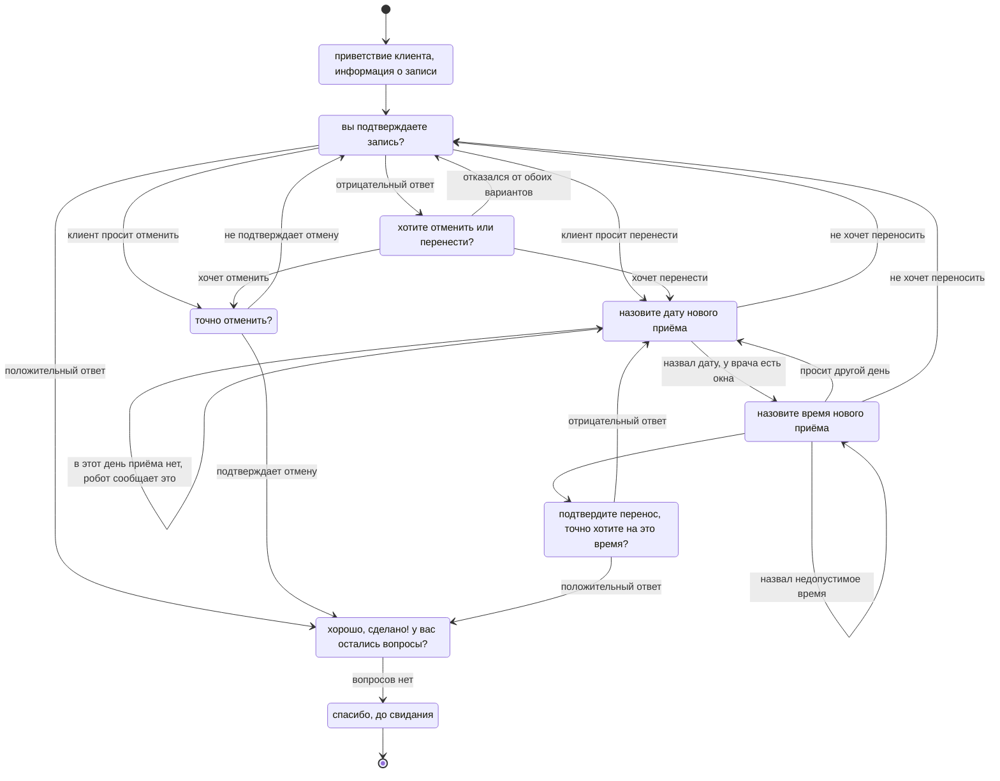
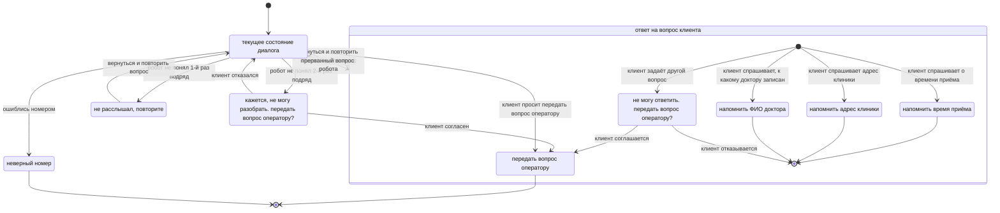

### Диаграмма состояний робота

Для удобства чтения я разбил диаграмму на две части
Первая часть показывает состояния в которых может находиться робот. Но так как "спагетти" читать не удобно, но возьмём в допущение, что при вопросе от клиента робот переходит к алгоритму ответа на вопрос клиента, а затем возвращается к прошлому состоянию (на диаграмме прерывания никак не показал)

Первая диаграмма:

Вторая диаграмма:

